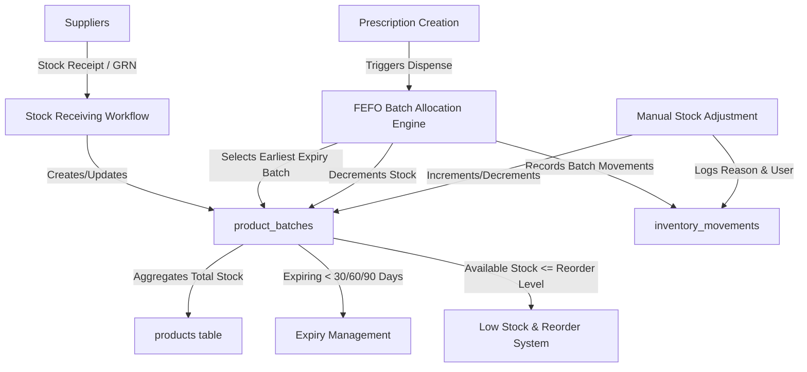

# INVENTORY_V2_IMPLEMENTATION_PLAN.md
## Pharmacy Inventory Management System V2 Upgrade Plan

---

### 1. Executive Summary & Core Objectives
Upgrade the existing basic inventory page into a **production-ready, enterprise Pharmacy Inventory Management System**. The system introduces **FEFO (First Expire, First Out) batch allocation**, multi-batch tracking per product, stock receiving (GRN) workflows, supplier management, stock adjustments, expiry management, and inventory movement audit logs.

---

### 2. Architecture & Data Flow



---

### 3. Database Schema Migration (`20261005010000_inventory_v2.sql`)

#### 3.1. `suppliers` Table
```sql
CREATE TABLE IF NOT EXISTS suppliers (
  id UUID PRIMARY KEY DEFAULT gen_random_uuid(),
  name TEXT NOT NULL,
  contact_person TEXT,
  phone TEXT,
  email TEXT,
  address TEXT,
  registration_number TEXT,
  notes TEXT,
  active BOOLEAN NOT NULL DEFAULT TRUE,
  created_at TIMESTAMPTZ NOT NULL DEFAULT now(),
  updated_at TIMESTAMPTZ NOT NULL DEFAULT now()
);
```

#### 3.2. `product_batches` Table
```sql
CREATE TABLE IF NOT EXISTS product_batches (
  id UUID PRIMARY KEY DEFAULT gen_random_uuid(),
  product_id UUID NOT NULL REFERENCES products(id) ON DELETE RESTRICT,
  batch_number TEXT NOT NULL,
  supplier_id UUID REFERENCES suppliers(id) ON DELETE SET NULL,
  quantity_received NUMERIC NOT NULL CHECK (quantity_received >= 0),
  quantity_available NUMERIC NOT NULL CHECK (quantity_available >= 0),
  purchase_cost NUMERIC NOT NULL DEFAULT 0 CHECK (purchase_cost >= 0),
  retail_price NUMERIC CHECK (retail_price >= 0),
  manufactured_date DATE,
  expiry_date DATE,
  received_at TIMESTAMPTZ NOT NULL DEFAULT now(),
  created_by UUID,
  status TEXT NOT NULL DEFAULT 'ACTIVE', -- ACTIVE, LOW_STOCK, EXPIRES_SOON, EXPIRED, DEPLETED, QUARANTINED
  created_at TIMESTAMPTZ NOT NULL DEFAULT now(),
  updated_at TIMESTAMPTZ NOT NULL DEFAULT now(),
  CONSTRAINT uq_product_batch UNIQUE (product_id, batch_number)
);
```

#### 3.3. `stock_receipts` & `stock_receipt_items` Tables (GRN)
```sql
CREATE TABLE IF NOT EXISTS stock_receipts (
  id UUID PRIMARY KEY DEFAULT gen_random_uuid(),
  receipt_number TEXT UNIQUE NOT NULL, -- e.g. GRN-20261005-0001
  supplier_id UUID REFERENCES suppliers(id) ON DELETE SET NULL,
  invoice_number TEXT,
  received_date DATE NOT NULL DEFAULT CURRENT_DATE,
  status TEXT NOT NULL DEFAULT 'COMPLETED', -- DRAFT, COMPLETED, CANCELLED
  total_cost NUMERIC NOT NULL DEFAULT 0,
  notes TEXT,
  created_by UUID,
  created_at TIMESTAMPTZ NOT NULL DEFAULT now(),
  updated_at TIMESTAMPTZ NOT NULL DEFAULT now()
);

CREATE TABLE IF NOT EXISTS stock_receipt_items (
  id UUID PRIMARY KEY DEFAULT gen_random_uuid(),
  receipt_id UUID NOT NULL REFERENCES stock_receipts(id) ON DELETE CASCADE,
  product_id UUID NOT NULL REFERENCES products(id) ON DELETE RESTRICT,
  batch_id UUID REFERENCES product_batches(id) ON DELETE SET NULL,
  quantity NUMERIC NOT NULL CHECK (quantity > 0),
  unit_cost NUMERIC NOT NULL DEFAULT 0 CHECK (unit_cost >= 0),
  retail_price NUMERIC CHECK (retail_price >= 0),
  expiry_date DATE,
  created_at TIMESTAMPTZ NOT NULL DEFAULT now()
);
```

#### 3.4. Enhanced `inventory_movements` Table
```sql
-- Extends movement types: STOCK_RECEIVED, DISPENSED, RETURNED, ADJUSTMENT_IN, ADJUSTMENT_OUT, EXPIRED, DAMAGED, TRANSFER_IN, TRANSFER_OUT, CANCELLED_DISPENSE
ALTER TABLE inventory_movements ADD COLUMN IF NOT EXISTS batch_id UUID REFERENCES product_batches(id) ON DELETE SET NULL;
ALTER TABLE inventory_movements ADD COLUMN IF NOT EXISTS reference_type TEXT;
ALTER TABLE inventory_movements ADD COLUMN IF NOT EXISTS reference_id TEXT;
ALTER TABLE inventory_movements ADD COLUMN IF NOT EXISTS reason TEXT;
```

#### 3.5. Enhanced `products` Table
```sql
ALTER TABLE products ADD COLUMN IF NOT EXISTS generic_name TEXT;
ALTER TABLE products ADD COLUMN IF NOT EXISTS brand_name TEXT;
ALTER TABLE products ADD COLUMN IF NOT EXISTS category TEXT;
ALTER TABLE products ADD COLUMN IF NOT EXISTS dosage_form TEXT; -- Tablet, Capsule, Syrup, Cream, etc.
ALTER TABLE products ADD COLUMN IF NOT EXISTS strength TEXT; -- 500mg, 250mg, 10mg
ALTER TABLE products ADD COLUMN IF NOT EXISTS sku TEXT;
ALTER TABLE products ADD COLUMN IF NOT EXISTS manufacturer TEXT;
ALTER TABLE products ADD COLUMN IF NOT EXISTS purchase_cost NUMERIC DEFAULT 0;
ALTER TABLE products ADD COLUMN IF NOT EXISTS reorder_level INTEGER DEFAULT 15;
ALTER TABLE products ADD COLUMN IF NOT EXISTS minimum_stock INTEGER DEFAULT 5;
ALTER TABLE products ADD COLUMN IF NOT EXISTS maximum_stock INTEGER DEFAULT 500;
ALTER TABLE products ADD COLUMN IF NOT EXISTS batch_tracking_enabled BOOLEAN DEFAULT TRUE;
ALTER TABLE products ADD COLUMN IF NOT EXISTS expiry_tracking_enabled BOOLEAN DEFAULT TRUE;
ALTER TABLE products ADD COLUMN IF NOT EXISTS rx_required BOOLEAN DEFAULT TRUE;
ALTER TABLE products ADD COLUMN IF NOT EXISTS is_active BOOLEAN DEFAULT TRUE;
```

---

### 4. FEFO (First Expire, First Out) Dispensing Logic

When a prescription item requests quantity \( Q \):
1. Query active, non-quarantined, non-expired batches for the `product_id`:
   ```sql
   SELECT * FROM product_batches 
   WHERE product_id = :productId 
     AND status = 'ACTIVE' 
     AND quantity_available > 0 
     AND (expiry_date IS NULL OR expiry_date > CURRENT_DATE)
   ORDER BY expiry_date ASC NULLS LAST, created_at ASC;
   ```
2. Loop over batches, allocating stock until requested \( Q \) is satisfied.
3. For each allocated batch:
   - `quantity_available = quantity_available - allocated_qty`
   - Record `inventory_movements` row with `batch_id`, `movement_type = 'DISPENSED'`, `quantity = -allocated_qty`, `stock_before`, `stock_after`.
4. Update `products.stock_quantity = SUM(product_batches.quantity_available)`.
5. Execute all operations inside **one database transaction**.

---

### 5. API Endpoints & Next.js Routes

#### Backend NestJS Endpoints (`apps/api/src/inventory/*`, `products/*`, `suppliers/*`):
- `GET /inventory/summary` (Valuation, total units, stock states, expiry counts)
- `GET /inventory/alerts` (Prioritized attention list)
- `GET /inventory/batches` & `GET /inventory/batches/:id`
- `GET /inventory/movements`
- `POST /inventory/receipts` (Stock Receiving / GRN)
- `POST /inventory/adjustments` (Manual Stock Adjustments)
- `GET /inventory/low-stock` & `GET /inventory/expiry`
- `GET /inventory/analytics` (Fast/Slow moving items, valuation trend)
- `GET /suppliers` & `POST /suppliers`

#### Frontend Routes (`apps/web/app/admin/inventory/*`):
- `/admin/inventory` (Overview Dashboard & Attention Center)
- `/admin/inventory/products` (Catalog with pagination & multi-filters)
- `/admin/inventory/products/[id]` (Product 360 & Stock Movements)
- `/admin/inventory/batches` (Batch Directory)
- `/admin/inventory/movements` (Movement Audit Ledger)
- `/admin/inventory/suppliers` & `/admin/inventory/suppliers/[id]`
- `/admin/inventory/receiving` (Multi-item GRN Receipt Wizard)
- `/admin/inventory/expiry` (Expiry Exposure Matrix)
- `/admin/inventory/low-stock` (Reorder Suggestions)
- `/admin/inventory/adjustments` (Stock Adjustment Workflow)
- `/admin/inventory/analytics` (Fast/Slow Moving Items & Valuation)

---

### 6. Implementation Milestones & Verification
1. Create Database Migration (`20261005010000_inventory_v2.sql`).
2. Build NestJS Modules: `InventoryModule`, `SuppliersModule`, FEFO service methods in `PrescriptionsService`.
3. Implement Server Actions in `apps/web/app/actions/inventory.ts` & `suppliers.ts`.
4. Build Next.js 16 App Router UI pages under `/admin/inventory/*`.
5. Verify build with `pnpm run build` and run unit test suite with `pnpm --filter api test`.
6. Produce `INVENTORY_V2_COMPLETION_REPORT.md`.
