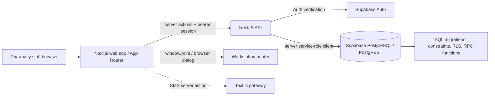

# Pharmacy SaaS Current Stage Assessment, Gap Analysis, and Development Roadmap

**Audit snapshot:** 19 October 2026  
**Scope:** Repository source, migrations, tests, and existing audit/deployment reports. No source code, database, or configuration was changed for this audit.  
**Verification boundary:** This is a static repository audit. Existing test and staging reports are cited as recorded evidence, not represented as tests rerun for this report. No live Supabase project, printer, SMS gateway, payment processor, deployment, or pharmacy operation was exercised.

**Checks performed for this report:** API Jest unit/integration suite: 18 suites and 171 tests passed (`pnpm --filter api test -- --runInBand`). Web Vitest suite could not start: esbuild config bundling failed with `spawn EPERM` in the execution environment; no web assertions ran. Database/migration suites were not run because they require a local PostgreSQL harness; no remote database was contacted. No production data was read or changed.

## Executive summary

The repository is a **pre-commercial pharmacy operations product centered on prescription labels and dispensing records**, with a meaningful but not yet operationally verified inventory foundation. It is not a complete pharmacy management SaaS and cannot currently perform POS sales, take payments, issue customer invoices, run cashier shifts, or manage multiple tenants and branches.

The strongest reusable work is the label workstation and Sinhala instruction composition; a NestJS API with authentication and role checks; a PostgreSQL/Supabase schema for patients, medicines, batches, movements, receipts, prescriptions, events, and audit records; and transactional SQL functions for receiving and adjustments, plus an optional transactional dispensing path. Reports describe extensive local unit, SQL, concurrency, and HTTP/database testing. Those are positive engineering assets, but reports also explicitly state that the migrations were not applied to the real Supabase project, and physical printing was not tested.

The principal release blockers are operational and product-level: no POS/invoice domain at all; dispensing defaults to a legacy path that updates product totals without updating batch quantities; its compensating multi-request writes are not a single atomic database transaction; tenant isolation and commercial subscription/branch management are absent; and deployment gates (credential rotation, migrations, roles, real staging verification) remain open in the supplied readiness report. The label layout is carefully measured in a browser/PDF but has unresolved overflow cases and no physical printer sign-off.

**Recommended stage:** advanced prototype / internal pilot candidate after staging gates, not production-ready and not a pharmacy MVP for checkout. Complete a controlled staging release and reconcile current stock first. Then deliver a sale/receipt foundation backed by atomic database transactions, with sale-linked dispensing/labels and inventory allocation. Do not enable batch-level transactional dispensing in production until batch balances are physically reconciled and the pharmacist approves the allocation rules.

## Current development stage

Status definitions: **COMPLETE** means code and verification evidence support the stated narrow capability; **PARTIAL** means meaningful implementation exists with material gaps; **MISSING** means no implementation found; **BROKEN** means a reproducible failure is documented in repository evidence; **UNVERIFIED** means code exists but real operation cannot be confirmed. Status does not assert legal or production compliance.

| Module | Status | Evidence-based completion estimate | Priority | Main gaps |
|---|---|---:|---|---|
| Prescription labels | PARTIAL | ~70% of the scoped standalone workflow; 0% physical sign-off | P0 | Browser-based print only; physical output unverified; stress cases intentionally block; no direct POS conversion |
| Prescription/dispensing records | PARTIAL | ~65% | P0 | No full prescription intake/review/renewal workflow; default write path is non-atomic and leaves batch balances stale; pharmacist approval decisions remain |
| POS and sales | MISSING | 0% | P0 | No cart, sale, payment, invoice, hold/resume, cashier, or sale return domain/routes/UI |
| Customer invoice/receipt | MISSING | 0% | P0 | No invoice entity, numbering, receipt template, payments, credit notes, or reprint flow |
| Medicine catalogue | PARTIAL | ~60% | P0 | Product CRUD and search exist; pack conversion/units and barcode uniqueness semantics need review; no price history |
| Inventory | PARTIAL | ~65% | P0 | Batches, FEFO rules and ledger are modeled; legacy dispensing does not decrease batches; no POS integration/physical counts/transfers/reservations |
| Supplier and goods receiving | PARTIAL | ~50% | P1 | Supplier CRUD and receipt posting exist; no purchase order, approval, supplier balance/payment, purchase return workflow beyond stock adjustment |
| Patients | PARTIAL | ~55% | P1 | CRUD/search and prescription association exist; no robust consent/retention/export controls, allergy verification workflow, or purchase history from sales |
| Dashboard and reports | PARTIAL | ~35% | P1 | Inventory/dispensing analytics exist; no sales/revenue/margin/cashier reports; metrics do not represent sales |
| Staff and authorization | PARTIAL | ~40% | P1 | Global authentication and route role checks exist; no in-app user administration/invites, branch-scoped roles, or fine-grained permission matrix |
| Returns/refunds | PARTIAL | ~25% | P1 | Patient returns can be held/disposed; supplier adjustments exist; no sales return, refund, exchange, or credit note |
| Multi-tenant SaaS and branches | MISSING | 0% | P1 | No organization, branch, membership, tenant key, subscription, billing, onboarding or tenant-scoped query design |
| Security/operations | PARTIAL / UNVERIFIED | ~45% | P0 before pilot | RLS migrations and audit schema exist locally; service role bypasses RLS; live migration/auth, credential rotation, backup restore, monitoring and recovery not proven |

Estimates above are planning judgments from visible feature slices, not measured completion statistics. A module may have strong code coverage for a narrow slice while remaining incomplete as a business workflow.

## Existing system and architecture

### Technology

- **Monorepo:** pnpm workspaces and Turborepo (`package.json`, `pnpm-workspace.yaml`, `turbo.json`).
- **Web:** Next.js 16 App Router, React 19, TypeScript, Zustand, Tailwind CSS 4, Recharts. Web screens use server actions as an API boundary (`apps/web/package.json`, `apps/web/app/actions/`).
- **API:** NestJS 11, TypeScript, class-validator, Supabase JS client (`apps/api/package.json`). Global `ValidationPipe` uses `whitelist: true` in `apps/api/src/main.ts`.
- **Data:** Supabase Auth and PostgreSQL via PostgREST/Supabase JS. SQL migrations live in `apps/api/supabase/migrations/`; no ORM is present.
- **Testing:** Jest unit/e2e and database suites, SQL migration/concurrency scripts, Vitest web tests, and Playwright-style browser scripts exist. The readiness report records local results; this audit did not rerun them.
- **Deployment:** docs describe Vercel/web plus an API/Supabase deployment path, but actual deployed environments and current remote migration state are unverified.

### Existing component communication

The API globally authenticates routes except explicitly public health/login handlers and applies `@Roles` checks where declared (`apps/api/src/app.module.ts`, `auth/auth.guard.ts`, `auth/roles.guard.ts`). Database calls use a server-side service-role key (`supabase.service.ts`), which bypasses RLS. This means RLS is useful as defense in depth for direct/public database clients but **does not itself isolate API tenants**; the API would need tenant-scoped authorization and every query/RPC would need that scope.

Key code references (relative to repository root): global authentication and role guard registration, `apps/api/src/app.module.ts:12-37`; auth token validation, `apps/api/src/auth/auth.guard.ts:24-76`; role enforcement, `apps/api/src/auth/roles.guard.ts:8-27`; validated environment and legacy default, `apps/api/src/config/env.validation.ts:22-74`; service-role client, `apps/api/src/supabase/supabase.service.ts:16-28`; global DTO whitelist, `apps/api/src/main.ts:8-25`.

### Reusable records and database design

Current migrations model `customers`, `products`, `product_batches`, `inventory_movements`, `suppliers`, `stock_receipts`/items, `prescriptions`/items/events, idempotency keys, profiles/settings, SMS records, audit logs, and patient returns. See `docs/DATABASE_SCHEMA.md` and `apps/api/supabase/migrations/`. Inventory movements, batch constraints, FEFO indexes, idempotency, and SQL RPC transaction boundaries are useful foundations.

Important absent domains: organizations/tenants, branches, user memberships, purchase orders, POS sales and sale lines, payment attempts/tenders, invoices, refunds/credit notes, cashier shifts, subscription plans/entitlements, and branch stock transfers. Legacy `labels` and `label_sessions` coexist with prescriptions; prescriptions are the newer primary record, so future work should avoid adding another source of truth.

## Existing features supported by repository evidence

- Label workstation with product/barcode search, patient search, multiple labels, dosage controls, Sinhala/English instruction composition, duration/expiry entry, review, save, save-and-print, print event logging, and SMS action paths (`apps/web/app/label/page.tsx`, `components/label/`, `lib/labelBuilder.ts`, `apps/api/src/prescriptions/`).
- Label print CSS targets 70 × 50 mm, uses browser `window.print`, and has a fit guard and development sample page. `docs/PRINT_LAYOUT_AND_STAT_OPTIONS.md` records 14 test labels in PDF and explicitly says physical printing is still outstanding. Some busy or long-name cases block printing by design.
- Patient and medicine search/CRUD, supplier CRUD, inventory overview, batch list, expiry/low-stock, movement history, receipt, adjustment, quarantine/release, and held patient-return screens/routes exist (`apps/web/app/admin/`, API modules in `apps/api/src/`).
- Prescription create/list/detail, print and SMS event routes exist. Prescription creation validates medicine, quantities, instructions, expiry and stock; it has idempotency handling. There are legacy and transactional modes, with transactional mode opt-in (`PRESCRIPTION_WRITE_MODE`).
- SQL functions implement stock receipt/adjustment and an optional transactional prescription/FEFO flow (`20261010000500_returns_quarantine_dispensing.sql`). Migration tests and staging documents report concurrency and rollback tests on disposable local PostgreSQL.
- Authentication verifies Supabase users; route-level role guards protect selected stock/supplier/product/destructive actions. Product and inventory DTOs have validation rules in the current tree.
- Basic dashboard, inventory analytics, top products/alerts and settings screens exist, but analytics are based on prescription/stock records rather than sales. SMS server action integration is present; the staging report says its gateway was mocked in tests, not sent live.

Useful line references: the label payload and implicit quantity fallback are at `apps/web/app/label/page.tsx:70-91`; save-before-print and `window.print()` are at `apps/web/app/label/page.tsx:134-175`; 70×50 mm page rule is at `apps/web/components/PrintableLabel.tsx:329-331`; prescription write-mode selection is at `apps/api/src/prescriptions/prescriptions.service.ts:68-104`; SQL stock-receive/adjust/dispense functions are in `apps/api/supabase/migrations/20261010000500_returns_quarantine_dispensing.sql:104-262`, `:262-445`, and `:446-623`; restrictive RLS setup is `apps/api/supabase/migrations/20261010000400_row_level_security.sql:20-44`.

## Missing features and business impact

### P0: Pharmacy counter and stock correctness

1. **Sales/POS:** There are no sale tables, API routes, or POS pages. A pharmacy cannot record retail sales, take payment, create a basket, hold/resume a sale, or reconcile cashier cash. Impact: the central daily workflow is absent.
2. **Invoices and receipts:** No invoice or payment persistence, receipt printer layout, credit note, or invoice reprint. Inventory purchase supplier invoice references are not customer sales invoices. Impact: no auditable checkout or customer receipt.
3. **Atomic sale and dispensing:** No single server-side transaction can validate price, allocate batches, write sale/items/payments, decrement stock, create dispensing/labels, and return an invoice. Without this, retry/crash/concurrent checkout could create duplicate charges or divergent stock/sales.
4. **Unit/pack conversion:** Product `pack_size` exists, but no verified conversion model or sale line base-unit normalization. Whole-unit prescription quantity validation exists. Selling tablets from strips and pack price/unit price rules need explicit modelling.
5. **Physical label sign-off:** No printer model/driver/stock test. PDF measurements cannot prove die-cut alignment, Sinhala glyph rendering, darkness/readability, margins, or multi-label feed behavior.

### P1: Complete pharmacy operations

- Purchase orders, review/approval, partial receipts against orders, supplier invoice matching, supplier payables, supplier returns/credits and purchase reports.
- Physical stock count sessions, variance approval, inter-branch transfers, reservation/available-stock distinction, and cost valuation policy.
- Sale returns/refunds/exchanges with sale references, policy and payment reversal; patient-return quarantine is not a sales refund.
- Unified customer/patient record with consent, deduplication, verified allergy handling, prescription history, repeat-dispense controls and purchase history.
- Cashier shifts, opening float, cash/card/mobile payment reconciliation, void/discount/refund approvals.
- Sales-derived dashboard: gross/net sales, refunds, margin methodology, tax totals, tender reconciliation, cashier and branch comparisons.
- User invitation/deactivation, least-privilege permissions, branch assignments and audit attribution for every change.

### P2/P3: SaaS and expansion

- Organization/tenant lifecycle, branch hierarchy, tenant-aware database keys/queries, onboarding/data import/export/deletion, subscription/billing/entitlements, trials and usage limits.
- Production backup/restore drills, monitoring, alerting, incident procedures, uptime targets, rate limiting, API throttling, SMS delivery callbacks and key rotation procedures.
- Optional forecasting/reorder recommendations and external integrations only after transactional sales, stock and cost data are reliable.

## Broken, inconsistent, and unverified areas

| Finding | Status / impact | Evidence and next action |
|---|---|---|
| Legacy dispensing path decreases `products.stock_quantity` but not `product_batches.quantity_available` | Documented open data integrity issue; batch reports/expiry/value overstate remaining stock and FEFO is not authoritative | `docs/STAGING_READINESS_REPORT.md` §2 F1; `apps/api/src/prescriptions/prescriptions.service.ts` has legacy default and transactional opt-in. Reconcile physical batches and totals before enabling transactional mode. |
| Label save silently substituted quantity 1 when the operator left quantity blank | **Resolved locally in Phase 1:** unset quantity is visible as unset and blocks review/save/print until explicitly entered; no pharmacist-approved default is assumed | See `PHARMACY_PHASE_1_IMPLEMENTATION_REPORT.md` and current code at `apps/web/app/label/page.tsx`, `components/label/ProductToolbar.tsx`, and `lib/labelQuantity.ts` |
| Legacy prescription writes use multiple API database operations plus compensation, not one PostgreSQL transaction | Partial-write risk remains if a write and its compensating rollback both fail | Service comments and implementation in `prescriptions.service.ts`; transactional RPC exists but is off until pharmacist approval. |
| New migrations are not confirmed applied remotely | Current app/schema compatibility and public database exposure depend on deployment state | `docs/STAGING_READINESS_REPORT.md` §3 says five migrations not applied to Supabase; run the staging checklist and verify environment, do not infer remote status from local files. |
| Print output not tested on a physical label printer | Clinical label production readiness unverified | `docs/PRINT_LAYOUT_AND_STAT_OPTIONS.md` §8–9. Execute its documented checklist on target stock/printer after staging. |
| Fit guard blocks some complex labels; there is no split-across-label workflow | Staff must remove instructions or save without printing; risk of operational friction | Print report cases S7/S12/S13 and label fit implementation. Pharmacist must approve smallest name text / clinical readability and escalation procedure. |
| Printer selection, silent printing, printer health, retry and spool status are not implemented | Browser owns print dialog; no proof of successful physical output | `window.print()` in `apps/web/app/label/page.tsx`; settings may hold printer name but no bridge is shown. |
| POS, receipt printer workflow, payment retries and refunds do not exist | Cannot run a complete retail pharmacy | No sales/payment/invoice API or tables found; schema docs explicitly say POS/accounting out of scope. |
| No tenant isolation model | Not safe to host independent pharmacies as shared SaaS | No organization/branch foreign keys or tenant scopes in migrations. RLS policies are restrictive for public roles, but service-role queries bypass them. |
| Source and docs contain in-flight changes | This audit snapshot is not a clean release candidate | `git status --short` showed extensive modified and untracked source/docs at audit time. Changes are shared workspace state; compare them to intended release/commit before staging. |
| Prior verification is not a live acceptance test | Real Supabase Auth/PostgREST, SMS, printer, deployment and backup recovery remain unverified | `docs/STAGING_READINESS_REPORT.md` §5.3. Its local PostgreSQL and adapter-based results are valuable but bounded. |

The previous Phase 0 report documents resolved defects (fabricated fallback records, weak API error handling, dummy configuration, and test setup issues) and still-open actions such as credential rotation, migration/staging execution, SMS rate limiting/logging, and middleware/session rendering concerns. Reconfirm each finding against the current branch before treating the historical finding as current; do not restore old reports' superseded fallbacks as present behavior.

## Label printing improvement report

**Current assessment:** Strong label-authoring and browser-layout implementation; not physically production-verified. Keep the 70 × 50 mm target pending printer validation. Treat clinical text, dose, quantity, printed expiry, patient identity and overflow block as safety-critical.

### P0 — before real dispensing use

- Apply migrations and verify actual database save/dispense behavior on a disposable staging pharmacy, including no-stock, expired, inactive, timeout, duplicate retry and print-log failure cases.
- Complete the physical checklist in `docs/PRINT_LAYOUT_AND_STAT_OPTIONS.md` for the exact printer, driver, label roll, 100% scale/no margins; record photos and pass/fail for all scenarios.
- Require pharmacist review for the approved Sinhala/English wording, instruction ordering, STAT behavior, minimum readable font, label fit-block messages, and what staff do when printing is blocked.
- Reconcile existing batch records with a physical count before using batch-level availability as ground truth. Clarify whether save-without-print means a dispensed medicine; current UI describes it as completed prescription/dispensing, so workflow must make that explicit.
- Surface saved prescription number and print state; permit reasoned reprint from history and differentiate “saved”, “sent to browser dialog”, and “physically printed” (the app cannot know the last state).

### P1 — streamline and connect to checkout

- Provide a single fast workflow: search/select medicine → choose patient or walk-in → dosage/instructions → preview → save/print. Preserve keyboard/scanner focus and avoid modal churn at counter.
- Add “create sale from prescription” and “create label from sale item” actions that reuse a single persisted dispense line and patient/product snapshots. Do not duplicate data entry or deduct the same units in both workflows.
- Improve patient selection and identity confirmation; display product strength/form and selected batch/expiry where relevant. Separate pharmacy label quantity from units sold/dispensed.
- Add print queue/retry and a local print bridge only if the deployment needs unattended printing. Browser-based confirmation must not be represented as printer acknowledgement.

### P2 — resilience and throughput

- Add configurable templates per label stock/printer model, calibration profile and regression PDFs/images; support controlled per-site print settings.
- Consider a second continuation label only after clinical review of content split/order and a two-label physical test. Current implementation intentionally does not split busy content.
- Add measured keyboard shortcut/help and touch target accessibility review on the actual counter hardware.

## POS and invoice target architecture

### Counter workflow

1. Open cashier shift with counted float.
2. Search/barcode-scan products; display name, strength/form, price and eligible batch availability.
3. Add cart lines in normalized base units with pack conversion; allocate FEFO eligible batches on the server at checkout (or reserve them with expiration if the workflow needs long-lived carts).
4. Link an existing prescription or create a prescription/label for applicable medicine; require pharmacist workflow for prescription-only medicines according to approved rules.
5. Server recomputes price/discount/tax and checks permission; cashier records one or more tender methods.
6. One idempotent atomic commit writes sale, lines, batch allocations, stock ledger movements, payment records, invoice number and prescription/dispensing links. Define external card/mobile gateway authorization/capture and compensation separately; an external payment cannot be made atomic with PostgreSQL.
7. Print receipt/invoice and any medicine labels from immutable saved snapshots. Record print attempts/reprints and reason. Reprint does not mutate sale or stock.
8. Returns/refunds reference original sale and items; restocking is a separate pharmacist/stock-manager decision and must not automatically reintroduce patient-returned medicines.
9. Close shift and reconcile cash and non-cash tenders.

### First-sale data model and APIs

Recommended initial tables: `sales` (branch, cashier, customer/prescription, status, currency, totals, immutable business timestamps, idempotency key), `sale_items` (product snapshot, quantity in base unit, pack conversion snapshot, unit price/discount/tax, batch allocations), `payments` (method, amount, external reference, authorization/capture/refund state), `invoices` (unique sequence per legal/business scope, original document snapshot), `sale_returns`/items, `refunds`, and `cashier_shifts`/tenders. Add `branch_id` and `organization_id` consistently before multi-site SaaS, rather than retrofitting after sales data accumulates.

API candidates: `POST /sales/quote`, `POST /sales` with `Idempotency-Key`, `GET /sales`, `GET /sales/:id`, `POST /sales/:id/void` with restricted permission, `POST /sales/:id/returns`, `POST /returns/:id/refund`, `POST /shifts`, `POST /shifts/:id/close`, and `POST /invoices/:id/print`. Quote is advisory; checkout revalidates all inputs server-side. Use SQL transactions/RPC or a carefully designed transaction-capable backend; lock product/batch rows in deterministic order; enforce unique invoice/idempotency constraints; record append-only movements and reversal references.

### Receipt printing

Create separate 58 mm/80 mm thermal and A4 invoice templates with a shared immutable invoice model. Browser print is suitable for user-confirmed printing; it cannot silently select/confirm a local printer reliably. For unattended checkout, evaluate a signed local print agent/bridge with device enrollment, explicit job status, bounded retries, and no exposure of service credentials. Store whether the browser dialog was invoked, not a false “printed” acknowledgement. Test actual printer widths, cutter, margins, fonts, paper/label feed and reprints.

Tax invoice requirements depend on registration, supply type and currently effective rules. Sri Lanka IRD’s published VAT Act and Gazette materials specify mandatory tax-invoice content and record retention; have a Sri Lankan tax professional validate which pharmacy transactions require VAT/tax invoices and the currently operative format before launch. See [IRD VAT Act consolidation](https://www.ird.gov.lk/en/publications/Value%20Added%20Tax_Acts/VAT_Act_No_14%5BE%5D_2002_%28Consolidation_2025%29.pdf) and [Gazette 2463/05](https://www.ird.gov.lk/en/publications/Gazette_Documents/2025_2463-05_E.pdf). A simple receipt must not be mislabeled as a statutory tax invoice.

## Inventory and purchasing audit

The product record stores catalogue attributes and aggregate stock. `product_batches` stores received/available quantity, supplier, costs and dates. `inventory_movements` is intended as an append-only signed ledger with before/after totals and references. `stock_receipts` and receipt lines support goods receiving; `receive_stock` and `adjust_stock` SQL functions are designed to change receipt/batch/product totals/ledger together. Batch status includes quarantine and expiry states, with a FEFO index and a transaction-based dispensing function.

This is materially better than a single stock counter, but currently not a trustworthy full ledger in normal default operation: legacy prescription writes update product total but leave batch quantities stale (readiness report F1). Product total and sum of batch stock therefore can diverge. Batch records also do not represent pack/unit conversion. “Reserved stock” is not modeled. Stock-taking sessions, counted quantities, variance review, transfers, purchase orders, supplier balances and payments are absent. Inventory analytics based on `prescription_items` represent dispensing history, not retail sales; don't call them revenue or gross profit.

Recommended control model: all stock mutation goes through database transactions with lock ordering, idempotency, immutable movement records, actor/reason/reference, and consistency checks reconciling aggregate product balances against batches plus explicitly identified legacy/unbatched opening balances. Separate sale return, patient return, supplier return, damage, expiry write-off and recount. Expired/quarantined stock remains visible but not sellable. Use unit-of-measure base quantities and immutable conversion snapshots on transaction lines.

Purchasing should proceed as supplier → PO/approval → receive all or part into a GRN → validate batch/expiry/cost → update batch quantity and ledger atomically → match supplier invoice and payment separately. Never let a purchase order itself increase stock. Preserve purchase price history on receipt lines; define weighted-average/FIFO costing for valuation and gross margin before analytics.

## UI/UX improvement plan

- **Label workstation:** preserve touch-first instruction controls; reduce context switches in product/patient selection; keep the active label and dirty state obvious; block unsafe print with actionable field-level reason; show label number and save status. Confirm typography on actual Sinhala-capable printer.
- **Dashboard:** label every figure with source and as-of time. Until POS exists, call values prescription/dispensing or inventory measures, not sales/revenue. Hide unsupported “profit” metrics.
- **Medicines:** provide create/edit and searchable catalogue with generic/brand, strength, dosage form, SKU/barcode, base unit/pack conversion, controlled prices, and active state. Current product routes include CRUD, but UI create and endpoint wiring should be confirmed against staging.
- **Inventory:** organize Receiving, Batches/Expiry, Movements, Counts/Adjustments, Returns; require reason/permission for all stock changes and show before/after. Keep quarantine distinct from disposal and available stock.
- **POS (new):** counter layout with product search/results, cart, checkout summary/tenders, high contrast, keyboard/scanner behavior, loading/empty/offline states, and manager approval for discount/void/refund. Avoid checkout lock-in when a customer lacks a profile.
- **Invoice/print (new):** preview receipt/invoice and labels from the completed transaction; one clear retry/reprint action; no unverified printer-health status.
- **Patients/prescriptions:** differentiate verified allergy information from unknown; link prescriptions to dispensing/sales, include prescriber and clinical review data where required, and protect access to sensitive fields.
- **Admin/settings:** add staff/branch management only after the underlying tenant model exists; settings should expose validated printer/layout and timezone choices, not claim capabilities that are not actually checked.

## Security, compliance, and SaaS readiness

### Security findings

- Positive controls: API global authentication, Supabase token verification, route roles for selected sensitive operations, DTO validation, startup environment validation, SQL constraints, idempotency, restricted RPC grants and RLS migration are documented/in source.
- **Critical SaaS limitation:** service-role database client bypasses RLS. There is no tenant key in current data entities or query contracts. Do not onboard multiple pharmacies to the shared project until tenant identity is part of authorization and enforced in every read/write/RPC (prefer database-enforced tenant context/policies with tests, and minimize service-role bypass).
- Authorization is coarse. Many read routes permit any authenticated user, role metadata is global, and no pharmacy/branch membership or field-level access policy exists. Define pharmacist, cashier, inventory manager, branch manager, owner and support-admin capabilities, then enforce in API/database.
- Readiness report records outstanding exposed-credential rotation and remote migration/RLS gates. Treat its rotation item as open until owner verifies completion through a secret manager/control-plane process; never put key material in this report.
- SMS is a third-party transfer of customer information; confirm consent/notice, data minimization, rate limits, opt-out, delivery logging, provider retention and incident response. Staging report lists moving SMS fully into API, recording outcomes and rate limiting as follow-up.
- Need verified backup schedules, point-in-time recovery, restore drills, monitoring/alerting, dependency scanning, rate limiting, operational audit review, incident response and data export/deletion procedure.

### Sri Lankan legal/regulatory checks

This report is not a legal opinion. NMRA publishes pharmacy and medicines regulations/guidance, including Good Pharmacy Practice and community pharmacy practice materials; get the pharmacist/regulatory advisor to map required prescription validation, dispensing, record keeping, labeling language and retention to the exact current rules ([NMRA pharmacy guidance](https://www.nmra.gov.lk/pages/pharmacy), [NMRA legislation](https://www.nmra.gov.lk/pages/legislation)). The NMRA site also lists an announcement concerning the tri-language dispensing-label policy; confirm applicability and effective requirements for the intended pharmacy setting before finalizing label content ([NMRA announcements](https://www.nmra.gov.lk/announcements)).

The Personal Data Protection Act, No. 9 of 2022 applies to relevant personal-data processing, but commencement and subsequent amendments/orders are date-sensitive. Obtain current Sri Lankan privacy counsel guidance on health data, controller/processor roles, lawful basis, notice/consent, retention, access/correction, breach handling, cross-border hosting and processor contracts; do not claim compliance from the presence of an audit table ([Data Protection Authority Act text](https://www.dpa.gov.lk/acts/Data%20Protection%20Act%20SL%20-%20English%20%282%29.pdf), [DPA guidance](https://www.dpa.gov.lk/guidelines.php)).

VAT/tax-invoice rules and formats are also current-date-sensitive. The IRD’s 2025 consolidated Act/Gazette and 2026 circular material should be reviewed by a tax advisor against the pharmacy’s registration and actual supply types before invoice implementation ([IRD 2026 circular](https://www.ird.gov.lk/si/publications/Circulars_Circulars/SEC_2026_E_03_S.pdf)).

## Technical architecture and migration strategy

### Preserve and extend

Keep the Next.js workstation, NestJS API, Supabase Auth/PostgreSQL, prescription/label rules, print guard, inventory queries/screens, and tested transactional SQL foundations. Avoid a rewrite. First consolidate verified runtime behavior and remove any stale duplicate domain logic before adding sales.

### Target architecture

- Organization owns branches; users join through memberships with branch-scoped roles and explicit support access.
- Each business record is organization-scoped; inventory, cashier shifts and receipts are branch-scoped. Every API reads tenant/branch scope from verified membership, never a client-supplied unrestricted ID.
- Catalogue may be organization-wide or branch overrides with explicit policy; stock is always branch/batch scoped.
- Prescriptions, dispensing, sales and labels connect through stable IDs and immutable snapshots; label print is a presentation of a persisted dispense item.
- Sales, payment intents/settlements, invoice documents, returns/refunds, inventory movements, audit events and shift tenders use separate but linked records.
- Database transactions own stock allocation and sale persistence. External payment capture uses an idempotent saga/outbox with reconciliation, not a promise of cross-system atomicity.
- Reporting reads from transaction ledgers/materialized views with documented definitions and timezone boundaries.

### Safe migration sequence

1. Inventory current schema and live data; back up and restore-test an isolated copy. Verify the migration ledger and RLS/public grants on the actual staging project.
2. Apply existing hardening migrations in documented order to staging only; reconcile product totals, batches, legacy/unbatched stock, and audit actors. Never re-run an older function migration after the final replacement migration.
3. Physically count/reconcile batches; make a pharmacist decision on undated stock and FEFO rules. Only then enable transactional dispensing in staging, verify rollback/idempotency/concurrency, and plan the production cutover.
4. Add organization/branch/membership schema before customer/sales multi-tenant rollout; backfill current records to one explicitly identified pilot organization and branch, verify every FK and query scope, then enable tenant-aware API.
5. Add sales/payment/invoice tables in additive migrations. Backfill no historical sales that were never recorded; opening balances should be separately labeled and auditable.
6. Release behind feature flags to one pilot pharmacy; reconcile sales and stock daily, then broaden. Keep rollback plans that preserve RLS, tenant boundaries and immutable transaction records.

## Prioritized backlog

Effort is person-weeks (one engineer-week ≈ one full-time engineer for a week); estimates include engineering and focused review but not procurement/owner delays. Uncertainty is medium/high until staging is available.

| Priority / task | Complexity | Estimate | Dependencies | Acceptance criteria |
|---|---|---:|---|---|
| P0: Clean release baseline and run safe local suites/builds; resolve intentional in-flight changes | M | 1–2 | Working-tree review | Reproducible branch/commit; clean builds and documented test results; no unexplained local changes |
| P0: Rotate exposed credentials; establish staging Supabase, backup/restore, apply/verify migrations and RLS | M | 1–2 engineering weeks + owner setup | Owner/control-plane access | Staging auth/roles/RLS verified; restore drill succeeds; no secret leakage |
| P0: Reconcile all product and batch quantities; approve dispensing rules and transactional mode | M | 1–3 operational weeks | Physical stock count, pharmacist | Every product has reconciled quantity/source; test scenarios pass; signed approval before mode switch |
| P0: Physical 70×50 label and Sinhala acceptance | S/M | 2–4 days plus hardware time | Target printer/labels, pharmacist | Checklist in print report passed and evidence stored; blocked cases have agreed staff procedure |
| P0: Define product units/pricing, prescription-only policy, sales/refund/tax scope | M | 1–2 weeks | Owner, pharmacist, accountant | Signed workflow/data decisions and testable acceptance criteria |
| P0: Tenant/branch/user membership security foundation | L | 4–7 | Data ownership and role decisions | Cross-tenant negative tests for every route/RPC; branch-scoped auth; audit actor identity verified |
| P0: Atomic POS core: catalog lookup, cart, checkout, idempotency, batch allocation, sale, stock ledger | L | 6–10 | Unit/pricing model; transactional DB design | Concurrent duplicate/retry and last-stock tests; no negative stock/partial sale; reconciliation report balances |
| P0: Invoice/receipt, payments (cash first), reprint and sales history | M/L | 3–5 | Sale schema, pharmacy settings | Unique serial; immutable totals/snapshot; 58/80 mm and A4 tests; reprint leaves sale/stock unchanged |
| P0: Prescription/label linked dispensing in POS; label-only and prescription-only paths retained | M | 2–4 | POS, approved pharmacy rules | One dispense and one stock deduction only; linked history; pharmacists approve required gates |
| P1: Sales returns/refunds, void permission, cashier shifts/reconciliation | L | 4–7 | POS/payment model | Return references original lines; refund idempotency; tender and shift close reconcile |
| P1: Purchase orders, partial GRNs, supplier invoice/payables and purchase reporting | L | 4–7 | Supplier/costing decisions | PO does not alter stock; receive updates batches/ledger atomically; supplier balance reconciles |
| P1: Stock count/variance approval and branch transfers | M/L | 3–5 | Branch model and tenant scope | Count snapshots and approved variance movements; transfer pair balances and is auditable |
| P1: Sales/inventory dashboard and financial reports | M | 3–5 | Stable sale and cost ledgers | Metric definitions documented; independent reconciliation to transactions; timezone tested |
| P1: Privacy, SMS consent/retention, audit completeness, ops monitoring/restore drills | M | 3–6 | Legal review, staging | Runbooks, alerts, data lifecycle and restore evidence; rate limits and actor IDs verified |
| P2: SaaS subscription, metering, billing and self-service onboarding | L | 5–9 | Tenant foundation, chosen billing provider | Trial/upgrade/dunning/expiry/tenant export tested; access remains isolated during status transitions |
| P2: Advanced forecasting and external integrations | M/L | 4+ | Reliable multi-month sales and stock data | Forecast quality evaluated on historical data; human override and provenance available |

## Development roadmap and release gates

Assumptions: one full-time senior full-stack engineer, part-time QA, pharmacist/product owner available weekly, and a separate accountant/privacy reviewer. Add 30–50% elapsed time if only one part-time engineer or decisions/staging access are delayed. Parallel staffing can reduce calendar time only after interfaces and data decisions are stable.

| Phase | Indicative elapsed time | Deliverables | Release gate |
|---|---:|---|---|
| 0. Baseline and staging stabilization | 2–4 weeks | Freeze/review current in-flight changes; credential rotation; disposable staging; migration/RLS/auth verification; batch reconciliation; physical label test | No fabricated runtime data; no unresolved critical persistence/stock mismatch; staging backup restore and pharmacist-approved labels |
| 1. Data and tenancy foundation | 4–7 weeks | Organization, branch, membership, scoped roles, migration/backfill, audit attribution | Automated cross-tenant/branch denial tests across every API/RPC; reviewed data protection design |
| 2. POS and customer invoice MVP | 9–15 weeks | Cash sales, cart, barcode lookup, unit pricing, atomic stock allocation, invoice/receipt, prescription/label link, sales history | Duplicate/concurrent/stock/race/reprint tests; daily sale-to-ledger reconciliation; pilot printer acceptance |
| 3. Inventory and purchasing completion | 6–10 weeks | Count/variance, PO/GRN, supplier obligations, unit conversion, transfers, stock valuation | Product/batch/ledger reconciliation; no expired/quarantined sale; supplier and cost reports reconcile |
| 4. Business controls and reporting | 6–10 weeks | Returns/refunds, cashier shifts, approvals, sales/stock reports, operational analytics | Return/payment/shift audit; finance signs off metric and tax definitions |
| 5. SaaS commercial launch readiness | 6–10 weeks | Onboarding, subscription/billing, limits, backup/monitoring/support workflows, export/delete | Security/privacy review, restore/incident drill, subscription lifecycle tests, production runbooks |
| 6. Advanced capabilities | 4–12+ weeks | Forecasting, supplier recommendations, integrations | Measured business case and accuracy/operational evaluation before release |

**Planning range:** a usable single-pharmacy checkout MVP with verified labels and reconciled stock is roughly **4–6 months** with the assumed team and prompt owner/pharmacist access. A tenant-safe, supportable commercial SaaS with purchasing, refunds, reporting, billing, backup/recovery and production operations is roughly **8–12 months**. These ranges exclude third-party certification, major data cleanup, legal review, payment-provider onboarding and hardware procurement.

## Cost and resource estimates

The estimates below are engineering effort, not vendor quotations. At a blended delivery capacity of one senior engineer plus part-time QA/product review, expect roughly **30–50 person-weeks** through single-pharmacy MVP and **55–85 person-weeks** through a robust SaaS launch (overlap between phases is possible; ranges are intentionally broad). A delivery team of two engineers plus QA can reduce calendar time, not total effort, and increases coordination needs.

Infrastructure and operating spend cannot be responsibly priced from this repository: hosting region/provider, database tier, traffic, retention, backups, SMS volume, payment provider, and support SLA are unspecified. Budget line items for web/API hosting, managed PostgreSQL/Supabase, point-in-time backups, logs/metrics/error reporting, SMS, payment processing, domain/email, security review, and support. Get current quotes before committing a budget. Hardware procurement should include the actual 70×50 label printer/stock and one or more 58/80 mm receipt printers; test each supported model and driver. A print bridge adds workstation install/update/support cost. Payment processor fees and tax/accounting integration costs require provider/accountant quotes.

## Final recommendations

1. **Current stage:** advanced prototype / internal pilot candidate after staging verification, not production-ready commercial SaaS.
2. **Working today (code evidence):** standalone label entry/review/save/print-dialog path; patient/medicine data access; prescription history/events; meaningful inventory receiving, adjustment, batch and alert modules; authentication and some role enforcement. Real remote operation remains unverified.
3. **Missing:** POS, customer sales, payments, invoices, cashier shifts, sales refunds, purchase-order/payable flows, branches, tenant lifecycle, subscription management and production operations.
4. **Label production-ready?** No. Layout is 70×50 mm and PDF-tested, but physical printer test is explicitly outstanding and difficult overflow cases block.
5. **Can it operate as a complete pharmacy POS?** No POS implementation or sales/payment schema/routes found.
6. **Customer invoices:** implement immutable invoice/sale records, unique numbers, payment/tax snapshots, reprint history, legal content decisions, receipt/A4 layouts and actual hardware verification.
7. **Inventory reliable?** Transactional receiving/adjustment design is promising; current default prescription dispensing leaves batches stale, so batch quantities/FEFO reports cannot be trusted until reconciliation and a controlled transactional cutover.
8. **Biggest technical/business risks:** stale stock/batch divergence, no checkout/invoice, remote migration/security status unknown, service-role bypass with no tenant boundaries, physical print not verified, and sensitive patient data governance not completed.
9. **Develop first:** establish a clean staging baseline, rotate credentials, verify/apply migrations, reconcile stock, get pharmacist label approval and physical printer sign-off; then define sale/unit/tax/tenant decisions before implementing atomic checkout.
10. **Reuse:** current web/API/Supabase stack, label composer/fit guard, prescription records/events, catalogue, batches/ledger, transactional SQL functions, role/auth foundation, supplier/GRN screens and existing test harnesses.
11. **Work to usable MVP:** estimated 4–6 months as scoped above, including real counter POS, invoices, stock reconciliation, printer verification and pilot.
12. **Work to commercial SaaS:** estimated 8–12 months with tenancy, privacy/security, subscriptions, branches, monitoring, recovery, support and full business controls.
13. **Security/business risks:** data leakage across future tenants, unrotated previously exposed credentials until confirmed rotated, unverified migration/RLS deployment, imprecise clinical workflow, incorrect inventory availability, and tax/privacy obligations not mapped to implementation.
14. **Target architecture:** tenant/branch-scoped Next.js + NestJS; verified membership authorization; PostgreSQL transactions/RPC for sale, stock and ledger; immutable sale/invoice snapshots; prescription/label links; external payment saga; audited print jobs; tested backups/monitoring.
15. **Efficient sequence:** staging and safety → reconcile inventory/label acceptance → tenancy and unit/pricing foundations → atomic POS and invoice → link prescriptions/labels → returns/shifts/purchasing → reports → SaaS onboarding/billing/operations → advanced analytics.

**Release principle:** do not represent a browser print dialog, local test pass, or UI screen as proof of physical print, remote deployment, sale/payment completion, or tenant safety. Gate each claim on the corresponding real acceptance evidence.
