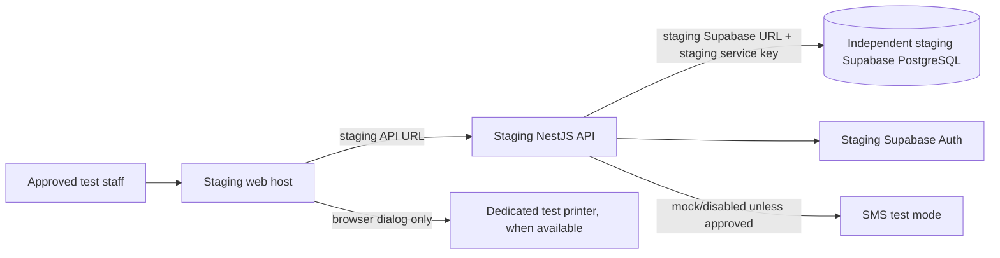

# Pharmacy Staging Environment Readiness

**Review date:** 19 October 2026  
**Branch:** `codex/phase1-safety-fixes`  
**Decision:** **BLOCKED — an independent Supabase staging project is not verified or configured in the repository.** No Supabase account was queried, no remote project was created, and no remote database was contacted.

## What was checked

- Repository branch and dirty working tree; existing changes were preserved.
- Supabase migrations, local disposable PostgreSQL test harness, API/web environment examples, current ignored local environment file metadata (variable names/configuration status only; secret values were not displayed), Supabase deployment guide, database security audit, staging checklist/runbook, authentication, roles and RLS test evidence.
- Local Supabase config directory and CLI availability.
- No remote `supabase projects list`, login, link, migration, API request or dashboard inspection was performed.

## Existing staging project determination

**Status: NOT VERIFIED.** There is no repository `supabase/config.toml`, no local `.supabase` project-link directory, and the Supabase CLI is not installed in this workspace. The checked-in documentation says migrations are prepared but not applied to the real Supabase project; it does not identify a verified independent staging project.

Ignored `apps/api/.env` and `apps/web/.env` files are present locally. A local-only metadata check found that their configured Supabase URLs resolve to the same project reference, neither reference has an evident `staging`/`test`/`dev` marker, and API `PRESCRIPTION_WRITE_MODE` is unset (the API validation defaults it to `legacy`). Secret values and project references were not printed. This does **not** prove those URLs point to production, but it also does not prove they point to staging. Treat the current local project target as **UNKNOWN / unsafe for staging operations** until the owner confirms it.

The two templates added for staging are placeholders only:

- `apps/api/.env.staging.example`
- `apps/web/.env.staging.example`

They contain no credentials and are not loaded automatically. Populate actual values only after the owner identifies/creates an independent staging project and API/web hosts. Keep the API service-role key in API-only secret storage. Do not overwrite the existing `.env` files.

Added `scripts/verify-staging-env.ps1` as a read-only, no-network preflight. It requires the operator to provide independently verified staging and production project refs plus the expected staging API URL; it checks that API/web Supabase URLs match the staging ref, the refs differ, the API key is present, the web config contains no service-role key, the write mode is explicitly `legacy`, and the web API URL matches the expected staging origin. It never prints values or secrets. It has not been run against actual staging config because no staging ref/files exist. It does not prevent an operator from bypassing the script or using a different deployment path, so provider-side environment separation and explicit project verification remain mandatory.

The preflight was exercised with synthetic temp files: a matching stage configuration passed, and changing the web Supabase URL to a different (production-like) ref produced `NO-GO`. No real project reference or credential was used.

## Staging architecture

The project ref, Auth users, database, API deployment, web deployment and credentials must be separate from production. Use synthetic-only pharmacy records and separate test email/password identities. Never copy production patients, prescriptions, supplier records, tokens or service keys. Provider backups and restore targets must be separate from the source project. The existing service-role API bypasses RLS, so the future staging tenant tests must enforce tenant scope in API/RPC design as well as database policy.

## Environment variable checklist

| Variable | Staging expectation | Status |
|---|---|---|
| `SUPABASE_URL` | Owner-verified staging project URL; same project ref as web public URL. | **BLOCKED** |
| `SUPABASE_SERVICE_ROLE_KEY` | New staging-only secret, API server only, rotated/managed outside source. | **BLOCKED** |
| `PORT` | API listen port; current code default is 3001. | **PASS** template prepared |
| `FRONTEND_URL` | Exact staging web origin(s), least-privilege CORS. | **BLOCKED** |
| `PHARMACY_TIMEZONE` | Owner-confirmed business timezone; current default Asia/Colombo. | **BLOCKED** decision |
| `PRESCRIPTION_WRITE_MODE` | Explicit `legacy` initially. Do not switch before reconciliation and pharmacist approval. | **PASS** safe template value; live config not changed |
| `NEXT_PUBLIC_API_URL` | Staging API only; must not point at production. | **BLOCKED** |
| `NEXT_PUBLIC_SUPABASE_URL` | Same verified staging project as the API. | **BLOCKED** |
| `NEXT_PUBLIC_SUPABASE_ANON_KEY` | Staging publishable key only. Never service-role key. | **BLOCKED** |
| `TEXT_LK_API_TOKEN`, `TEXT_LK_SENDER_ID` | Prefer absent/mock; otherwise staging-only and separately approved. | **BLOCKED / NOT TESTED** |
| Operator database connection string | Temporary secret for dump/restore/migration tooling; not an application setting. Never commit or log. | **BLOCKED** |

The environment examples are inventories, not proof that the deployment provider has these settings. Next.js does not necessarily auto-load a custom `.env.staging` file; use the hosting provider's Staging environment scope or an explicitly reviewed environment loader.

## Production-target safety assessment

**Status: FAIL in current app startup; mitigated by a new operator preflight that is not yet configured or run.** The current local API/web environment files use a matching Supabase project ref with no demonstrated staging label. The API takes its database URL/key directly from environment configuration. The new preflight script detects common target mismatches when run, but the application itself does not enforce the check and the script can be bypassed. The Supabase deployment guide uses linked-project CLI examples, which can target whichever project is currently linked.

Until this is corrected operationally:

1. Do not run Supabase CLI, migration scripts, seed scripts, backups, or application smoke tests against the current `.env` files.
2. Before any staging command, independently verify the project ref in the provider dashboard and compare it to both staging URLs and the intended operator target. Use explicit project selection rather than an implicit `--linked` target where the CLI supports it.
3. Record both staging and production project refs in an owner-controlled, non-secret environment inventory; require them to differ before any staging release.
4. Use a staging-only CLI profile/working directory and secrets; stop if a tool reports an unknown target, production ref, or credential.
5. Keep production credentials out of the staging shell and staging environment. Do not attempt to prove isolation by making a production connection.

Run the preflight against actual staging files and independently verify CLI/provider targeting before anyone runs remote migrations. This report does not claim the current application enforces that guard.

## Authentication, roles, RLS and permissions

**Local evidence: PASS, bounded. Remote staging: NOT TESTED.** Phase 1.5 records passing API coverage (18 suites/171 tests) and disposable PostgreSQL migration/RLS tests. These covered local missing/invalid token and role behavior, SQL grants, RLS enablement, public-role restrictions, and restricted RPC execute rights. They did not use actual Supabase Auth or a staging project.

Required staging tests after project verification:

- Create separate synthetic Auth accounts; assign approved app metadata roles using an authorized administrator. Do not reuse production users/passwords.
- Exercise login/logout, valid/absent/malformed/expired/revoked token, auth outage, API 401/403, disabled user, no-role and wrong-role cases.
- Verify route-by-route rights for patient access, prescription creation/dispensing, stock receipt/adjustment, quarantine/release, returns, audit reads and destructive actions. Owner/pharmacist must approve the dispensing role before it is enforced or accepted.
- Confirm public `anon` and `authenticated` data access matches the expected RLS policy/grants and service-role access is limited to the API runtime. Log actor IDs for sensitive writes.
- There is no tenant/branch schema. RLS tests on one tenant cannot prove multi-tenant safety. Do not onboard multiple pharmacies until membership-derived scope is enforced across every API query/RPC and cross-tenant negative tests pass.

## Migrations and synthetic inventory

**Local migration and inventory diagnostics: PASS** per `PHARMACY_PHASE_1_5_VERIFICATION_REPORT.md`; migration, transactional dispensing, concurrency, RLS permissions and read-only diagnostic fixtures passed on disposable PostgreSQL. **Remote staging migration and diagnostics: NOT TESTED.**

Use the sequence and gates in `PHARMACY_STAGING_RUNBOOK.md`. Do not run `apps/api/supabase/seed.sql`: it contains realistic contact numbers, medicine names/barcodes and stock quantities and is explicitly prohibited on a real project by `docs/SUPABASE_DEPLOYMENT_GUIDE.md`. For staging, use clearly labeled synthetic data and no real phone/email identifiers. Run `inventory_reconciliation_readonly.sql` only on staging after verifying project identity; all results are diagnostic, and no balance adjustment is automatic.

`20261010000500_returns_quarantine_dispensing.sql` changes behavior (including refusal of legacy `RETURNED` adjustments and receiving into quarantined batches). Confirm staged API/UI compatibility before a pilot. Never re-run `20261010000300_transactional_functions.sql` after 000500 without immediately restoring 000500 and re-verifying function definitions and grants.

## Backup and restore readiness

**Procedure prepared; provider backup and restore not tested.** Follow the encrypted, restricted, separate-target procedure in `PHARMACY_STAGING_RUNBOOK.md`. Verify both provider snapshot/PITR and logical dump where available, restore to a separate isolated project, compare migration ledger/schema/row counts/RLS/functions, provision Auth separately, then smoke test with synthetic accounts and records. Record restore point, elapsed time, data checks, missing provider-managed objects and reviewer sign-off. Never restore over production or use `db reset --linked`.

## Status decision

| Gate | Status | Why |
|---|---|---|
| Repository staging architecture and environment requirements documented | **PASS** | Architecture and placeholder-only templates prepared. |
| Staging preflight mismatch detection | **PASS, synthetic only** | Matching synthetic config passes; differing web project ref fails. |
| Existing independent Supabase staging project verified | **BLOCKED** | No local project link/CLI; provider account was not queried. |
| Staging project created and isolated | **BLOCKED** | Requires owner/provider access; not performed. |
| Staging credentials/users provisioned | **BLOCKED** | Requires owner and provider access. |
| Existing exposed secret/admin password rotated and revoked/reset | **BLOCKED** | Historical owner action; not verified or changed. |
| Production cannot be selected accidentally | **FAIL** | Current configuration lacks stage-vs-production guard and target identity is not verified. |
| Migration plan and verification queries prepared | **PASS** | Existing deployment runbook reviewed; expanded staging instructions exist. |
| Remote migrations applied and verified | **NOT TESTED** | No remote access or approval. |
| Auth/roles/RLS/database grants verified on staging | **NOT TESTED** | Local tests passed; no actual project exercised. |
| Synthetic pharmacy records on staging | **NOT TESTED** | No staging database exists/was accessed from this workspace. |
| Read-only inventory diagnostics on staging | **NOT TESTED** | Synthetic local fixture passed; no remote data read. |
| Backup and restore on provider staging | **NOT TESTED** | Procedure prepared; no provider backup/restore run. |
| Transactional dispensing production mode | **BLOCKED / KEEP DISABLED** | No physical reconciliation or pharmacist approval. |
| Staging pilot | **NO-GO** | Project isolation, credentials, remote verification, role approvals and recovery evidence are outstanding. |

## Next steps requiring owner action

1. Identify/create an independent Supabase staging project in the pharmacy’s account and provide its non-secret project ref to the operator. Confirm region/data residency and billing/backup capabilities.
2. Verify/revoke historically exposed production credentials through the provider; create new staging-only credentials. Do not send secrets to this repository or chat.
3. Provision isolated staging API/web hosting and test accounts. Fill the staging templates in provider secret settings; do not modify the existing `.env` files.
4. Implement/run a tested target-ref preflight; then take a staging backup and restore it to a separate isolated target.
5. Only after separate migration approval, apply migrations to staging in the documented order and execute auth/roles/RLS/API/diagnostic tests using synthetic data.
6. Keep the pharmacy pilot and POS blocked until physical inventory reconciliation, pharmacist sign-off, physical label acceptance and accounting decisions are complete.

This report authorizes no resource creation, credential changes, remote queries, migrations, deployment, stock changes or production access.
