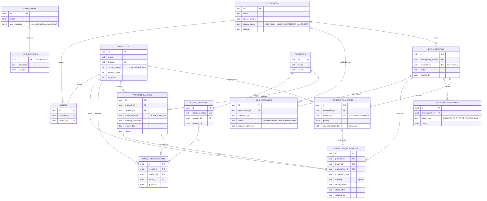

# Database ERD

Entity-relationship diagram of the schema after the Phase 3 migrations. Tables marked `(new)` are created by `20261010000200`. Column lists show keys and the fields that matter for relationships; see `DATABASE_SCHEMA.md` for every column.

Standalone tables (no foreign keys): `idempotency_keys`, `audit_log` (references rows by type and id text so history survives deletion), `pharmacy_settings` (single row; `updated_by` → `auth.users`), `label_sessions` (legacy).

## Delete behaviour

| Parent deleted | Effect on children |
|---|---|
| customer | prescriptions, labels, SMS keep their rows; `customer_id` set to null (name snapshot kept) |
| product | **blocked** while batches, receipt lines or ledger rows reference it (RESTRICT); prescription items keep their name snapshot |
| prescription | items and events deleted (CASCADE); ledger rows keep their history with `prescription_id` set to null |
| supplier | batches and receipts keep their rows; `supplier_id` set to null |
| stock receipt | its lines deleted (CASCADE) |
| auth user | profile deleted (CASCADE); `created_by` columns keep the id |

The application never deletes products, prescriptions, batches or receipts. Only an administrator can delete a patient record.
