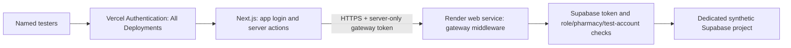

# Private synthetic staging — deployment package

This is a staging-only preparation package. No external project/service, repository
push, domain, deployment or hosted verification was performed. Production remains
NO-GO. The final gate status and executed results are in
[PRIVATE_STAGING_VERIFICATION.md](PRIVATE_STAGING_VERIFICATION.md).

## Architecture



Vercel cannot ordinarily reach a Render private-network service. This configuration
uses an Internet-routable Render web service with mandatory machine authentication
on every HTTP path, including login, health, unknown routes and side-effect paths.
The Vercel server adds the gateway header; browsers never receive that credential.
User bearer authentication and role checks remain required behind the gateway.
An obscure hostname and CORS are not treated as access controls.

All frontend URLs, assets, default domains, aliases and previews must also be covered
by **Vercel Authentication, All Deployments**, with named testers only. Disable
shareable bypass links, protection exceptions and unnecessary automation bypasses.
Do not launch if the account/plan cannot enforce that setting: use another identity
gateway with verified origin lockdown instead. This is an owner action that source
configuration cannot establish. See [Vercel protection documentation](https://vercel.com/docs/deployment-protection/methods-to-protect-deployments/vercel-authentication).

Render uses a TCP health probe because its configured HTTP probe cannot supply our
gateway credential. Application `/health` and `/health/db` remain authenticated at
the gateway; the latter also requires an authorized application account. TCP is
liveness only. Configure a separate authenticated readiness monitor and do not
relax the middleware for a spoofable health-check header or user agent.
See [Render health checks](https://render.com/docs/health-checks).

## Inspected compatibility and build inputs

- Active pnpm workspace: `apps/*`, `packages/*`. Do not select legacy `api/` or `types/`.
- Vercel project root: `apps/web`; include files outside this root for the monorepo
  install. Framework: Next.js. Use Node 22.x in project settings and confirm its
  actual patch version from provider logs. `.node-version` and package engines
  document the local supported runtime; Vercel controls available patch versions.
- Render service root: **repository root**. Node pinned to 22.23.4. The API binds
  `0.0.0.0` and the injected `PORT`. No fixed workstation port is required.
- Root pnpm version: 10.34.5. Install dev dependencies for TypeScript/Nest build;
  never start the dev server or Vitest UI on a host. Lockfile is authoritative.
- Next runs server actions and server-side API requests; it cannot be exported as
  static files. No privileged Supabase client is required in the frontend.
- Password login is server-to-server. No OAuth/callback route is implemented;
  do not invent an OAuth redirect flow. Server actions retain same-origin checks.
- Staging API CORS is disabled: all requests are server-to-server, and even OPTIONS
  must pass the gateway. The normal API profile retains explicit frontend-origin
  CORS. Configure a stable HTTPS staging frontend identity; never use `*` or all
  `*.vercel.app` domains. Browser API traffic goes through server actions.

Provider references: [Vercel monorepos](https://vercel.com/docs/monorepos),
[Vercel Node versions](https://vercel.com/docs/functions/runtimes/node-js/node-js-versions),
[Render Node pinning](https://render.com/docs/node-version), and
[Render web-service binding](https://render.com/docs/web-services).

### Vercel commands

Configuration: [apps/web/vercel.json](../apps/web/vercel.json).
From the configured `apps/web` root:

```sh
corepack pnpm --dir ../.. install --frozen-lockfile --prod=false --ignore-scripts
node ../../deploy/staging/build-web.cjs
```

Vercel starts the Next.js runtime; do not set a custom `next start` process there.
The staging build launcher requires the profile markers, then delegates to
`next build --webpack` with the current Node executable.
For a local built copy, the start command is `pnpm --filter web start`.
Enable Corepack in the provider environment. Repository Git auto-deployment is
disabled by the configuration; a deliberate authorized deployment is still needed.

### Render commands

Template: [deploy/staging/render.yaml](../deploy/staging/render.yaml).
Do not submit/import it until external resource creation is authorized. The template
specifies a paid starter service; the owner must approve cost before creating it.

```sh
corepack pnpm install --frozen-lockfile --prod=false --ignore-scripts
corepack pnpm --filter api build
node deploy/staging/start-api.cjs
```

`autoDeployTrigger` is off. Importing a Blueprint may still create resources and
perform an initial deployment: that action requires explicit approval. No migration
is part of the build/start command. Provider Corepack, Linux native dependencies,
gateway authentication and routing must be verified from the first authorized build;
local Windows success is not proof of hosted compatibility.
The staging API launcher rejects an omitted profile before loading `apps/api/dist/main.js`;
removing both frontend/backend environment markers cannot silently disable containment
when these staging launchers are used. Their missing-marker failure paths are tested.

## Environment names — values belong only in secret stores

| Scope | Required variable names |
|---|---|
| Both servers | `DEPLOYMENT_PROFILE`, `STAGING_DATA_POLICY`, `STAGING_GATEWAY_TOKEN`, `SMS_ENABLED` |
| Frontend | `API_URL`, `PILOT_API_URL`, `NEXT_PUBLIC_DEPLOYMENT_PROFILE`, `NEXT_PUBLIC_UI_TEST_MODE`, `ENABLE_EXPERIMENTAL_COREPACK` |
| API | `NODE_ENV`, `NODE_VERSION`, `PORT` (provider supplied), `SUPABASE_URL`, `STAGING_SUPABASE_URL`, `PILOT_SUPABASE_URL`, `SUPABASE_SERVICE_ROLE_KEY`, `PILOT_PHARMACY_ID`, `FRONTEND_URL`, `PHARMACY_TIMEZONE`, `PRESCRIPTION_WRITE_MODE` |
| Optional synthetic branding | `NEXT_PUBLIC_PHARMACY_NAME`, `NEXT_PUBLIC_PHARMACY_ADDRESS`, `NEXT_PUBLIC_PHARMACY_PHONE` |

Use the checked-in `.env.staging.example` files as unpopulated templates. Both profile
markers must select synthetic staging; the data policy must acknowledge synthetic-only
data. SMS must be disabled. Generate a fresh random 32-byte hexadecimal gateway token
directly in an approved password/secret manager; configure the same value only in
the two server environments. Never put it in `NEXT_PUBLIC_*`, a URL, repository,
browser request, report or chat. Never reuse a production credential.

API URL and approved API URL must identify exactly the same staging HTTPS origin.
All three Supabase URL names must identify the same dedicated staging project.
These matching values are a startup guard, not independent proof of isolation.
An administrator must verify actual provider project identity, contents and ownership.
Do not configure Supabase service-role credentials, SMS credentials or production
database connection strings in the frontend. The old public API/Supabase variables
are unnecessary for this server-action architecture.

## Owner execution sequence — only after explicit authorization

1. Review the preserved dirty source and the session delta. Establish a reviewed
   release commit and owner-approved remote. Do not push the current tree blindly.
2. Confirm final vulnerability/regression/build results in the verification report.
   Block Internet-routable deployment for unresolved exploitable critical findings.
3. Authorize/create a **new Supabase staging project**. Independently compare its
   project ID with production records and verify it is empty/synthetic. Do not
   restore production backups or copy patient data. Store credentials privately.
4. Disable new user signups in Supabase Auth general settings; disable anonymous,
   phone/SMS and unused OAuth providers. Allow only password access for manually
   provisioned named test accounts. Set Site URL and exact allowed redirects to the
   protected staging frontend; do not add production or wildcard callback URLs.
   Verify direct provider signup is refused, not merely hidden in the app.
   See [Supabase Auth configuration](https://supabase.com/docs/guides/auth/general-configuration).
5. After project/backup verification, apply the nine migrations below in order using
   that project's authorized migration workflow. Record hashes and migration ledger.
   Do not use destructive reset scripts on hosted/shared databases. Run RLS/grant
   verification for anonymous/authenticated roles and RPC permissions. No migration
   was applied remotely by this session.
6. Manually create test accounts without sending real invitations. Assign trusted
   **app_metadata** `role`, `pharmacy_id`, and `environment` through authorized
   administration. The environment marker must be `synthetic-staging`; the pharmacy
   UUID must match the staging configuration. Test admin/pharmacist/staff/cashier
   accounts separately. User-editable user_metadata must never grant access.
7. Authorize/create the dedicated Render web service with auto-deploy off and the
   reviewed template. Set staging-only secrets and actual protected frontend origin.
   Confirm an unauthenticated `/health`, login, data route and unknown route all
   refuse HTTP access. Use an authenticated operator probe for health/readiness.
8. Authorize/create a dedicated Vercel project, configure `apps/web`, Node/Corepack,
   environment names, private access and **All Deployments protection before sharing
   or routing test traffic**. Do not use the existing production project. Keep Git
   automatic deployments disabled. Obtain explicit authorization for the deployment.
9. Perform the fourteen hosted acceptance checks in the verification report. Create
   records through the protected UI: names start with `TEST`, reserved invalid email
   domains, fictional phone fixtures and a clearly separate synthetic inventory.
   No real names, prescription details, medicines issued to patients or payments.
10. Record actual hosted URLs, release/schema/lock/artifact hashes and testers only
    after deployment. Do not declare success from local builds or placeholder URLs.

Migration order:

```text
20260824000000_init.sql
20261005000000_prescription_domain_upgrade.sql
20261005010000_inventory_v2.sql
20261010000100_schema_hardening.sql
20261010000200_profiles_settings_sms_audit.sql
20261010000300_transactional_functions.sql
20261010000400_row_level_security.sql
20261010000500_returns_quarantine_dispensing.sql
20261025000100_reasons_catalogue.sql
```

## Staging restrictions and rollback

The profile blocks application print/print-and-save before persistence, adds a test
banner/watermark and substitutes a print-block message for the browser print command.
API print/reprint/SMS, onboarding and payment route families are blocked. SMS also
fails closed independently of the old flag. No payment integration is activated.
Normal authorized synthetic patient/product/inventory/prescription CRUD is retained.
Synthetic prescriptions can exercise existing stock behavior; **legacy stock mode is
unchanged and is not approved for real dispensing**. A test marker cannot technically
prevent an authorized tester from typing real data; access policy and supervision
must enforce the synthetic-only rule.

Rollback: keep the previous reviewed staging artifacts and environment-version
references. On uncertainty, suspend staging access and the API first; do not expose
an old unpatched artifact as a workaround. Roll back only to a compatible reviewed
staging release with the same isolation and gateway requirements. No database schema
change is introduced here, so do not run downgrade migrations. If staging data is
corrupt, restore a synthetic backup into a **new staging project**, validate schema,
counts, grants and Auth metadata, then explicitly authorize repointing both servers.
Never restore into production. Keep provider gateway secrets synchronized during
any authorized staging-only credential update. Re-run access and side-effect checks
before reopening. No restore, repointing or deployment has been executed.
